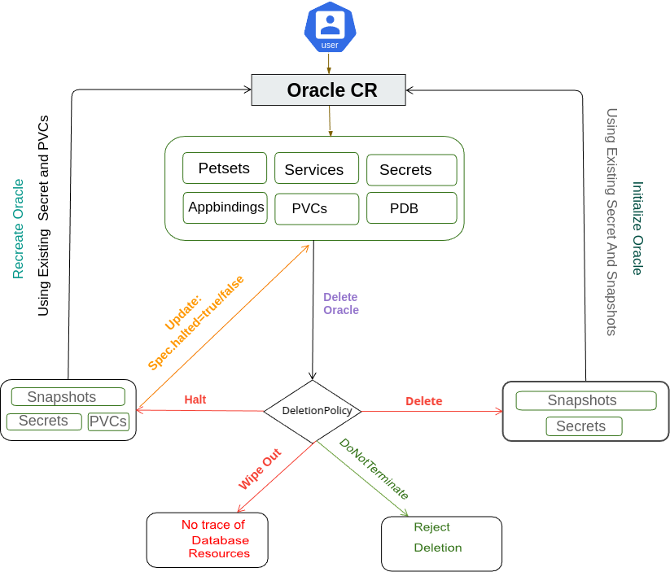

> New to KubeDB? Please start [here](/docs/README.md).

## Supported Oracle Features

| Features                           | Availability |
|------------------------------------|:------------:|
| Clustering                         |   &#10003;   |
| Data Guard                         |   &#10003;   |
| Synchronous Replication            |   &#10003;   |
| Streaming Replication              |   &#10003;   |
| Automatic Failover                 |   &#10003;   |
| Persistent Volume                  |   &#10003;   |
| Initialization using Script        |   &#10003;   |
| Using Custom docker image          |   &#10003;   |
| Base Backup using KubeStash        |   &#10003;   |
| Incremental Backup using KubeStash |   &#10003;   |
| Point-in-time Recovery             |   &#10003;   |

## Life Cycle of a Oracle Object

  

## User Guide

- [Quickstart Oracle](/docs/guides/oracle/quickstart/index.md) with KubeDB Operator.
- [Backup & Restore](/docs/guides/oracle/backup/overview/index.md) Oracle with KubeStash: [base backup](/docs/guides/oracle/backup/base-backup/index.md) and [incremental backup](/docs/guides/oracle/backup/incremental/index.md).
- Restore Oracle to a [point in time](/docs/guides/oracle/pitr/archiver.md) with an `OracleArchiver`.

