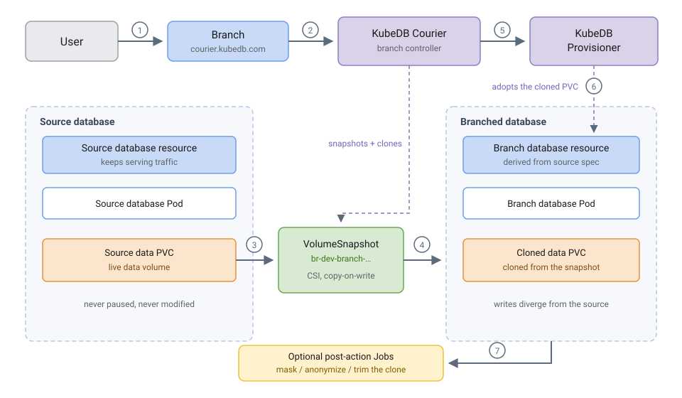
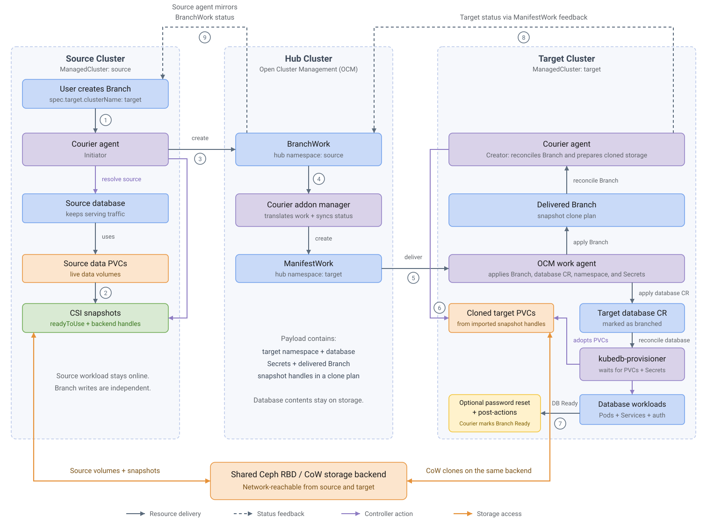

> New to KubeDB? Please start [here](/docs/README.md).

# Database Branching Overview

A database branch is a separate, writable database created from the schema and data captured in a source database's storage snapshot. Like a branch in a Git repository, it gives developers, tests, and automation a place to make changes independently. Each KubeDB branch is an ordinary KubeDB database with its own Pods, volumes, Services, and auth Secret. Writes to the branch do not change the source, and later source writes do not appear in the branch unless it is refreshed.

KubeDB uses CSI volume snapshots and copy-on-write (CoW) clones to create the branch's storage. A CoW clone initially references the snapshot's existing blocks instead of copying the entire data volume upfront. As source and branch writes diverge, the backend preserves the blocks needed by the snapshot and allocates storage for changes. The time until a branch is usable also includes storage preparation, database startup, and any requested post-actions.

The **KubeDB Courier** operator manages this process through a `Branch` custom resource in the `courier.kubedb.com` API group. Create the resource in the source cluster to branch into the same cluster or another cluster. Courier coordinates snapshots, cloned volumes, database provisioning, optional credential isolation, and post-actions before marking the Branch `Ready`.

## Why Branching Matters

- **Validate changes against realistic data.** Test schema changes and application behavior against existing data, constraints, and relationships before deploying them.
- **Keep development and CI independent.** Give each developer or test run its own database so concurrent work does not modify shared test data or schemas.
- **Reduce the cost of database copies.** CoW storage lets branches initially share snapshot blocks and consume additional space as their data diverges.
- **Make experiments disposable.** Recreate a branch after an unsuccessful backfill or destructive test instead of repairing a shared development database. The source continues serving its workload while Courier snapshots its storage.
- **Prepare data before sharing it.** Post-actions can mask sensitive fields, remove confidential tables or records, and load test fixtures before the Branch is reported `Ready`.
- **Give AI agents an isolated workspace.** With production credentials, an agent's generated query could delete records, alter database structure, or expose confidential information. Give the agent access to a branch after credential isolation and data sanitization complete, so it can experiment on prepared data without access to production.
- **Keep long-lived environments current.** Scheduled refreshes replace branch data with a new source snapshot and rerun its preparation steps.

Common uses include reproducing production bugs, rehearsing schema changes or bulk updates, seeding CI pipelines, and giving developers, QA teams, or analysts their own working datasets.

## How Branching Works

### Same-Cluster Branching

The source database and branch run in the same Kubernetes cluster. They can share a namespace or use different namespaces. The diagram shows the flow for a source data volume; Courier determines the volumes to snapshot according to the database engine.

<figure align="center">
  <a href="/docs/operatormanual/branching/images/branch_overview.svg" target="_blank" rel="noopener">
    
  </a>
  <figcaption align="center">Same-cluster branching. Select the diagram to open it at full size.</figcaption>
</figure>

1. A user creates a `Branch` that identifies the source KubeDB database and the target database's name, namespace, and optional storage and resource overrides.
2. Courier resolves the source database and discovers the data PVCs needed to create the branch.
3. Courier takes CSI snapshots of those PVCs while the source continues serving traffic. For multiple volumes, it uses a `VolumeGroupSnapshot` when a compatible group-snapshot class is available; otherwise it takes individual `VolumeSnapshot` objects. Individual snapshots do not provide an atomic snapshot across volumes.
4. Once the snapshots report `readyToUse`, Courier clones the target PVCs from them. A cloned PVC references a snapshot through its `dataSource`. If the target namespace differs, Courier first imports each snapshot handle into that namespace using a `VolumeSnapshotContent` and `VolumeSnapshot`.
5. Courier creates the target KubeDB database resource, deriving its configuration from the source and applying the Branch's overrides. It also copies the configuration and credential Secrets needed by the target.
6. The KubeDB provisioner adopts the cloned PVCs and starts the branch database on the cloned data. Courier completes any requested root-password reset before running post-actions.
7. If `spec.postActions` is configured, Courier runs the actions as Jobs against the branch, in order, with its connection environment injected. The Branch becomes `Ready` only after every action succeeds.

At `Ready`, the target has its own database resource, Services, AppBinding, and auth Secret. It can be reconfigured, backed up, and monitored through the usual KubeDB workflows for that database.

### Cross-Cluster Branching

Cross-cluster branching uses an existing **Open Cluster Management (OCM)** hub and two registered managed clusters: **source** and **target**. A Courier addon manager runs on the hub, and a Courier agent runs on each participating managed cluster. KubeDB and the databases run on the managed clusters.

<figure align="center">
  <a href="/docs/operatormanual/branching/images/branch_cross_cluster.svg" target="_blank" rel="noopener">
    
  </a>
  <figcaption align="center">Cross-cluster branching through an OCM hub. Select the diagram to open it at full size.</figcaption>
</figure>

1. Create the `Branch` on the source cluster and set `spec.target.clusterName` to the target's OCM `ManagedCluster` name.
2. The source Courier agent takes snapshots and waits for both snapshot readiness and the storage backend's snapshot handles.
3. The source agent creates a `BranchWork` in its own managed-cluster namespace on the hub. The payload includes the target database definition, required Secrets, and a delivered `Branch` carrying the snapshot clone plan.
4. The Courier addon manager translates the `BranchWork` into a `ManifestWork` in the target managed cluster's namespace on the hub.
5. OCM's work agent applies the payload on the target cluster, including the target namespace and the delivered Branch.
6. The target Courier agent imports the snapshot handles, creates cloned PVCs, and coordinates with KubeDB to bring up the target database on that storage.
7. The target agent completes any requested password reset and post-actions, then marks the delivered Branch `Ready`.
8. Target status returns through `ManifestWork` feedback to `BranchWork`, and the source agent updates the original Branch. Observe the original Branch on the source cluster for completion.

**Both managed clusters must use the same storage backend, reachable over the network from both clusters.** Courier and OCM deliver Kubernetes resource definitions and snapshot references through the hub; the CSI drivers access the shared backend directly to provide data and CoW clones. The hub does not relay database contents. Two independent Ceph installations do not satisfy this requirement.

Courier records each controller's role in `status.mode`:

| Mode | Meaning |
|---|---|
| `Local` | Courier performs the branching flow in one cluster. |
| `Initiator` | The source agent snapshots the source, sends work through the hub, and mirrors target status. |
| `Creator` | The target agent reconciles the delivered Branch, prepares cloned storage, and completes target-side operations. |

Leave `spec.target.clusterName` empty for same-cluster branching. Set it to another registered cluster's name for cross-cluster branching. See [setup and configuration](/docs/operatormanual/branching/setup.md) for the required Courier installation in each mode.

## What the Branch Inherits

Courier derives the target database from the source, applies the Branch's overrides, and adjusts the configuration for an independent database. The exact fields retained depend on the database engine; source topology and every spec field are not universally preserved.

| Carried over from the source | Controlled by the `Branch` |
|---|---|
| Database version | Target cluster, name, and namespace (`spec.target.clusterName`, `spec.target.name`, `spec.target.namespace`) |
| Storage settings, unless overridden | StorageClass (`spec.target.storageClassName`) |
| Custom configuration, with required configuration Secrets copied to the target namespace | CPU/memory requests and limits (`spec.target.resources`) |
| TLS settings, with fresh certificates for the target | TLS issuer for the branch (`spec.target.issuerRef`) |
| Applicable pod-template, monitoring, and other database configuration | Root credential: reuse the source credential in a separate Secret, or establish an independent credential (`spec.resetRootPassword`) |
| Data as of the snapshot | Post-clone data preparation (`spec.postActions`) |

The target database's `spec.deletionPolicy` is set to `Delete` while it is managed by the Branch. The Branch's own `spec.deletionPolicy` controls what happens when the Branch is deleted; see [Deleting a Branch](#deleting-a-branch).

The target database receives a `kubedb.com/branched-from` annotation recording its origin. For example, a branch of `source-db` in namespace `demo` on the `source` cluster records:

```json
{"cluster":"source","source":"demo/source-db"}
```

The cluster value can be empty for a local Courier installation without a configured cluster name.

## Branch Lifecycle

A `Branch` reports progress through `status.phase`:

| Phase | What is happening |
|---|---|
| `Pending` | The Branch has been accepted and is about to start. |
| `Snapshotting` | Courier is taking CSI snapshots of the source data volumes. |
| `Cloning` | Target PVCs are being cloned from the snapshots. |
| `Provisioning` | KubeDB is bringing up the target database on cloned storage. |
| `ActionsRunning` | The `spec.postActions` Jobs are running against the branch. |
| `Ready` | The branch is up and its requested preparation steps have completed. |
| `Refreshing` | A scheduled refresh is replacing branch data using a new source snapshot. |
| `Failed` | An operation failed; inspect `status.conditions` and `status.history`. |
| `Deleting` | Teardown is in progress. |

The phases observed depend on the mode and requested operations. For cross-cluster branches, target provisioning and action progress are reported back to the source Branch through the hub.

Alongside the phase, `status.conditions` records milestones:

`SnapshotReady` → `TargetCreated` → `TargetReady` → [`RootPasswordReset`] → [`PostActionsCompleted`] → `Ready`

The milestones in brackets apply when those features are requested. `status.resources` records owned resources such as cloned PVCs, the auth Secret, an optional configuration Secret, and post-action Job tracking. `status.snapshot` describes the source snapshot set, including the strategy, group reference when used, and each member's size and readiness.

## Keeping a Branch Fresh

A branch is a point-in-time copy. Set `spec.schedule.cron` to replace its data periodically with a fresh source snapshot:

```yaml
spec:
  schedule:
    cron: "0 2 * * *" # Daily at 02:00 in the Courier controller's timezone.
```

Courier takes the new snapshot before pausing the target, replaces its cloned volumes, restarts the database, and reruns requested credential isolation and post-actions. **Refresh discards branch-only writes and makes the branch temporarily unavailable.** Omit the schedule for a one-time branch. See [Refreshing Database Branches](/docs/operatormanual/branching/refresh.md) for scheduling, freshness, and history details.

## Resetting the Root Password

Give the branch an independent root credential instead of reusing the source credential:

```yaml
spec:
  resetRootPassword: true
```

Courier coordinates the password reset before post-actions and Branch readiness. The source credential remains unchanged. Read the branch credential from the target database's auth Secret once the Branch is `Ready`. See [Resetting a Branch Root Password](/docs/operatormanual/branching/reset-root-password.md) for execution order and verification.

## Post-Actions

Post-actions prepare the cloned data before consumers use it. For example, an action can mask personal information, drop sensitive tables, delete confidential records, or insert test fixtures. Add the action image to `spec.postActions`:

```yaml
spec:
  postActions:
    - image: ghcr.io/your-org/branch-sanitizer:v1
```

The image above is a placeholder for your own image containing the database client and preparation script. Courier injects the branch's connection environment and runs actions in list order as Jobs on the target cluster, after any requested password reset. Wait for the **Branch** to become `Ready` before giving consumers access to the prepared data; the database Service can exist before the actions finish. See [Running Branch Post-Actions](/docs/operatormanual/branching/post-actions.md) for Job configuration and runtime options.

## Deleting a Branch

`spec.deletionPolicy` decides what happens to the branched database when the `Branch` object is deleted:

| Policy | Effect |
|---|---|
| `Delete` (default) | Removes the target database, its cloned PVCs, auth Secret, snapshots, and post-action Jobs. The source database is untouched. |
| `Orphan` | Keeps the target as an independently managed KubeDB database. Branch ownership metadata is removed and the target's credentials and volumes are retained, so it continues working without Branch management. |

For cross-cluster branches, deletion propagates through the hub to the target cluster. The source agent releases source snapshots after target cleanup has completed.

## Failure Handling

If an operation fails, the Branch enters `Failed`, records a `Failed` condition, and adds an entry to `status.history`. Retry behavior depends on the failure and whether the Branch has a schedule:

- **A terminal post-action Job failure waits for a spec correction.** Courier suspends the Job, retaining the failed Pod and logs subject to the Job's retention settings. Correct the action specification and reapply the Branch to trigger a retry. Actions should tolerate Job retries and repeated execution.
- **A one-time branch remains `Failed` until its specification changes.** Correct the configuration that caused the failure and reapply it.
- **A scheduled branch retries other transient failures automatically**, with a backoff of about one minute. This allows recovery when a refresh fails after the target has already been paused. A failure while taking the fresh source snapshot leaves the existing target data running.

Inspect the original Branch on the source cluster. For cross-cluster failures, also inspect the delivered Branch and relevant Jobs on the target cluster for the underlying operation's details.

## Requirements

Prepare the following before creating a Branch:

- **KubeDB and Courier:** KubeDB must manage the source and target databases, and Courier must be installed with the Branch CRDs. For a single-cluster KubeDB installation, enable Courier with `--set kubedb-courier.enabled=true`. See [setup and configuration](/docs/operatormanual/branching/setup.md).
- **Snapshot and CoW storage:** Use **Ceph RBD or equivalent CoW-capable CSI storage for both same-cluster and cross-cluster branches**. The source volumes must already use that backend. Install the CSI snapshot CRDs, snapshot controller, and the driver's snapshot support in each participating cluster.
- **Compatible snapshot and storage classes:** A `VolumeSnapshotClass` must exist for the source CSI driver. Courier selects a compatible class, preferring the driver's default; use `spec.volumeSnapshotClassName` to choose one explicitly. The target StorageClass must use the same CSI driver and be able to restore the source snapshots. Classes referenced for target-side snapshot imports must also exist on the target.
- **Group snapshots when needed:** Capturing multiple data volumes as a consistent group requires the group-snapshot APIs, controller and driver support, and a compatible `VolumeGroupSnapshotClass`. Otherwise Courier uses individual snapshots, which are not atomic across volumes.
- **Cross-cluster coordination and shared storage:** An existing OCM hub must have the source and target clusters registered and available, with the Courier addon manager on the hub and agents enabled on both managed clusters. Both clusters' CSI installations must resolve the source snapshot handles against the **same network-reachable storage backend**, with compatible driver configuration and credentials.

Snapshot support comes from the CSI driver and storage backend. StorageClasses such as `hostPath` or `local-path` that lack snapshot and CoW support cannot provide this workflow. See [Branch Snapshot Configuration](/docs/operatormanual/branching/snapshots.md) for snapshot-class selection, namespace imports, and shared-backend compatibility.

## Branching vs. Backup vs. Migration

These workflows copy data for different purposes:

| Feature | Question it answers | Result | Source |
|---|---|---|---|
| **Branching** | "Can I get an independent copy to develop or experiment against?" | A writable database created from storage snapshots, in the same or another cluster | A KubeDB-managed database |
| **Backup & Restore** | "If this database is lost, how can I recover it?" | A retained backup, such as data in object storage, that can be restored on demand | A database configured for backup |
| [Migration](/docs/operatormanual/migration/README.md) | "How do I move an existing database into KubeDB?" | A destination database populated for a controlled cutover | An existing external database |

A branch and its source share a storage backend, even when they run in different Kubernetes clusters. CoW clones also initially share snapshot blocks. A branch therefore does not provide an independent durable copy against loss of that backend. Use a backup and recovery workflow for durability, and branches for independent working copies.

## Next Steps

- [Setup and Configuration](/docs/operatormanual/branching/setup.md): install Courier for same-cluster or cross-cluster branching.
- [Snapshot Configuration](/docs/operatormanual/branching/snapshots.md): prepare CoW storage, snapshot classes, and shared-backend access.
- [Refresh](/docs/operatormanual/branching/refresh.md): keep branch data current on a schedule.
- [Reset Root Password](/docs/operatormanual/branching/reset-root-password.md): give a branch its own root credential.
- [Post-Actions](/docs/operatormanual/branching/post-actions.md): sanitize or seed data before making a branch available.
